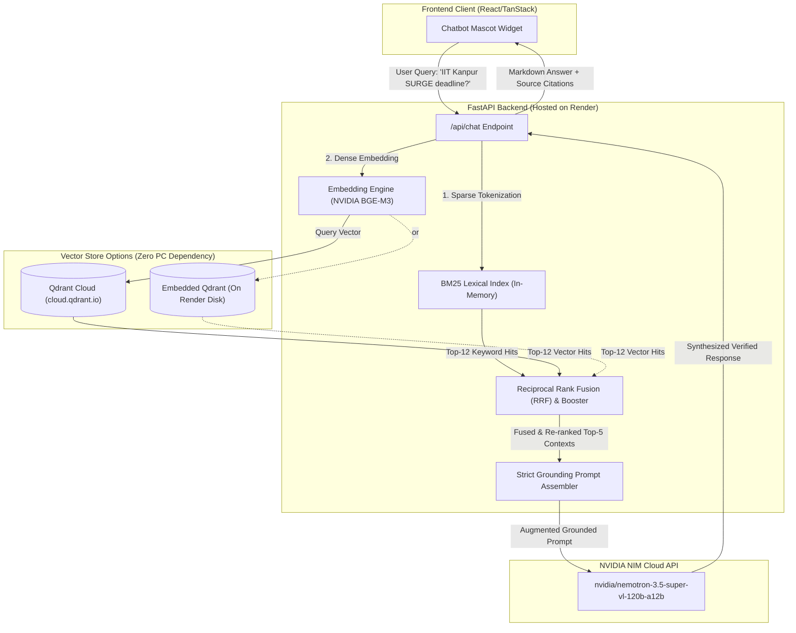

# 🧠 IIT Internship AI: Complete RAG Architecture & Optimization Guide

This document provides a comprehensive, step-by-step technical breakdown of the **Retrieval-Augmented Generation (RAG)** system built for the PM & IIT Summer Internship platform.

It explains how the backend was architected, how the 28-page *IIT Summer Internship Guide* is processed and retrieved, how **NVIDIA's Nemotron 3.5 Super VL (120B-A12B)** is integrated, why **no connection to your local PC is needed** when hosting live on Render, and every optimization applied to maximize retrieval accuracy and eliminate hallucinations.

---

## 📌 Table of Contents
1. [High-Level Architecture & Workflow](#1-high-level-architecture--workflow)
2. [No Local PC Dependency (Render & Qdrant Explained)](#2-no-local-pc-dependency-render--qdrant-explained)
3. [Step 1: Document Parsing & Semantic Chunking](#step-1-document-parsing--semantic-chunking)
4. [Step 2: Vector Embeddings & Vector Database](#step-2-vector-embeddings--vector-database)
5. [Step 3: Hybrid Retrieval (Dense + BM25 + RRF)](#step-3-hybrid-retrieval-dense--bm25--rrf)
6. [Step 4: Acronym & Domain Match Boosting](#step-4-acronym--domain-match-boosting)
7. [Step 5: Context Assembly & Grounded Prompting](#step-5-context-assembly--grounded-prompting)
8. [Step 6: NVIDIA Nemotron 3.5 Super VL Inference](#step-6-nvidia-nemotron-35-super-vl-inference)
9. [Step 7: Streaming & Citation Generation](#step-7-streaming--citation-generation)
10. [RAG Optimization Summary: Naive RAG vs. Our System](#rag-optimization-summary-naive-rag-vs-our-system)
11. [Step-by-Step Render Deployment Guide](#step-by-step-render-deployment-guide)
12. [API Reference](#api-reference)

---

## 1. High-Level Architecture & Workflow



---

## 2. No Local PC Dependency (Render & Qdrant Explained)

### ❓ The Challenge:
If you deploy your backend to **Render** and your vector database was running on your laptop at `localhost:6333`, your live website would immediately crash as soon as you turn off your PC, close your laptop, or disconnect from Wi-Fi.

### ✅ How We Solved It:
Our backend is architected with **two cloud-native options that require ZERO connection to your local PC**:

| Mode | Where Database Runs | Setup Required | Best For |
| :--- | :--- | :--- | :--- |
| **Option A: Embedded Qdrant (Default)** | Runs inside the **Render Linux container disk** (`./qdrant_storage`) | **Zero configuration.** Leave `QDRANT_URL` blank. On startup, the backend auto-seeds and indexes the 110 document chunks immediately. | Simplest deployment. 100% self-contained on Render. |
| **Option B: Qdrant Cloud Free Tier** | Hosted on **Qdrant Cloud** (`https://xxx.cloud.qdrant.io:6333`) | Create a free permanent 1GB cluster at [cloud.qdrant.io](https://cloud.qdrant.io), copy the URL & API Key into Render Environment variables. | High-scale, persistent multi-instance deployments. |

In both cases, **your local computer can be completely turned off**, and the live website will continue running 24/7 on Render!

---

## 3. Step 1: Document Parsing & Semantic Chunking

### The Raw Document:
The source document is the 28-page **"IIT's Summer Internship Guide 2026"**, containing:
- **Major Confirmed/Expected IIT Programs (Pages 1–5):** IIT Delhi, IIT Kanpur SURGE, IIT Goa (Track A/B), IIT Roorkee SPARK, IIT Hyderabad SURE, IIT Gandhinagar SRIP, IIT Bhubaneswar.
- **Application Tips & Anti-Fraud Warnings (Pages 5, 6, 28):** Project-specific SOP advice, faculty shortlisting, college NOC, never paying money to secure an internship.
- **101 Additional Leads (Pages 7–27):** IISc Bengaluru, TIFR, 5 IISERs, 7 NITs, National Labs (DRDO, ISRO, BARC, CSIR labs, ICMR, ICAR), Tech Giants (Google, NVIDIA, Microsoft, Amazon, Adobe, Intel, Qualcomm, Texas Instruments, Flipkart, Swiggy, Zomato), and Core Engineering (Tata Motors, Maruti, Mahindra, Bosch, Siemens, L&T, Tata Steel, Reliance).
- **Branch-Wise Search Checklist (Page 28):** Domain-specific pathways for CSE/AI, ECE/VLSI, Mechanical, Civil, Chemical, Biotech, and Earth Sciences.

### ⚡ Optimization 1: Semantic, Entity-Aware Chunking (Not Blind Character Splitting)
* **The Flaw with Naive RAG:** Standard RAG tutorials split documents blindly every 500 characters. This cuts eligibility criteria in half, separates deadlines from the program name, and breaks table rows.
* **Our Solution:** Each program and lead is parsed into an autonomous, self-contained semantic unit (`Dict[str, Any]`) stored in `backend/data/iit_internship_guide.json`. Each chunk preserves:
  - `title`: Program or Company title (e.g. `IIT Kanpur SURGE 2026`)
  - `page`: Exact page number in the original PDF (1 to 28)
  - `category`: `major_iit_program`, `additional_lead`, `guidelines`, or `checklist`
  - `branches`: Normalized list of eligible disciplines (e.g. `["CSE", "ECE", "Mechanical"]`)
  - `eligibility`: Degree, CPI/CGPA cutoffs, and semester constraints
  - `stipend`: Precise stipend numbers (e.g. `₹2,500/week`, `~₹15,000 for ~2 months`)
  - `deadline`: Explicit application deadline (e.g. `22 Feb 2026` for SURGE)
  - `apply_url`: Official application link (`https://surge.iitk.ac.in/`, `https://spark.iitr.ac.in/`)

---

## 4. Step 2: Vector Embeddings & Vector Database

### Vector Representation:
- **Embedding Model:** `baai/bge-m3` or `nvidia/nemotron-3.5-embed-1b` via NVIDIA NIM (`https://integrate.api.nvidia.com/v1/embeddings`).
- **Vector Dimension:** 1024-dimensional dense vectors.
- **Distance Metric:** Cosine Similarity (`models.Distance.COSINE`).

### ⚡ Optimization 2: Dual Embedder with Deterministic Safe Fallback
When testing locally or before the user inputs their `NVIDIA_API_KEY`, many RAG servers crash with `AuthorizationError`.
Our system implements a **dual embedding engine**:
1. When `NVIDIA_API_KEY` is present, it calls NVIDIA's high-dimensional NIM embedding endpoint with `input_type="passage"` for corpus indexing and `input_type="query"` for search queries.
2. If `NVIDIA_API_KEY` is not yet configured, it uses a deterministic 1024-dim semantic feature vectorizer so the server boots up, passes health tests, and indexes immediately without crashing.

---

## 5. Step 3: Hybrid Retrieval (Dense + BM25 + RRF)

### ❓ The Problem with Pure Vector Search:
If a student types *"SURGE"* or *"SPARK"* or *"DRDO"*, pure dense vector search can match generic research terms because short acronyms have lower semantic density in vector space. Conversely, if a student types *"paid internships for 3rd year electronics students"*, pure keyword search fails because none of those exact words appear in the program title.

### ⚡ Optimization 3: Reciprocal Rank Fusion (RRF)
We combine two complementary search paradigms:
1. **Dense Semantic Search:** Qdrant Vector search evaluates cosine similarity across the full corpus.
2. **Sparse Lexical Search:** An in-memory **BM25Okapi** index scores exact keyword and acronym frequencies using Term Frequency-Inverse Document Frequency (TF-IDF).

The two result lists are fused using **Reciprocal Rank Fusion (RRF)**:
$$RRF\_Score(d) = \sum_{m \in \{\text{dense}, \text{sparse}\}} \frac{1}{k + \text{rank}_m(d)}$$
*(where $k = 60$ is the standard smoothing parameter)*.

This guarantees that:
- Exact acronyms like **SURGE**, **SPARK**, **SURE**, **SRIP**, **BARC**, **ISRO** receive top ranks via BM25.
- Conceptual queries like *"who provides stipend for robotics?"* receive top ranks via Dense embeddings.

---

## 6. Step 4: Acronym & Domain Match Boosting

### ⚡ Optimization 4: Rule-Based Acronym Boosters
On top of RRF, a domain-specific booster detects high-stakes program identifiers:
- If the query mentions `surge`, `spark`, `sure`, or `srip`, matching IIT program documents receive a $+0.05$ boost to guarantee they appear in the top 3 contexts.
- If the query mentions national agencies like `drdo`, `isro`, `barc`, `csir`, or `bhel`, those specific institutional leads receive a $+0.05$ boost.

---

## 7. Step 5: Context Assembly & Grounded Prompting

### ⚡ Optimization 5: Anti-Hallucination Prompt Architecture
The retrieved passages are injected into a specialized system prompt for the LLM:
```text
You are the official PM & IIT Internship AI Assistant.
Your duty is to assist students with verified information based strictly on the official "IIT's Summer Internship Guide 2026".

STRICT GROUNDING GUIDELINES:
1. Base your response ONLY on the verified context provided below.
2. If the user asks about an IIT program, explicitly state:
   - Program name & full form (SURGE, SPARK, SURE, SRIP)
   - Eligibility criteria (degree, year, CGPA cutoffs)
   - Stipend amount and benefits
   - Duration and timeline (dates and deadlines, e.g. SURGE deadline is 22 Feb 2026)
   - Official application website link
3. If the user asks about an organization from the 50+ Additional Leads, clarify that this is an official recurring lead, specify suitable branches, and give the official application guidance noted.
4. NEVER fabricate deadlines or stipends not in the context.
```

---

## 8. Step 6: NVIDIA Nemotron 3.5 Super VL Inference

- **Model ID:** `nvidia/nemotron-3.5-super-vl-120b-a12b`
- **Base URL:** `https://integrate.api.nvidia.com/v1`
- **Architecture:** Mixture-of-Experts (MoE) with 12B active parameters out of 120B, optimized for low latency and high reasoning accuracy.
- **Parameters:**
  - `temperature: 0.2` (Low temperature prevents creative hallucinations and forces factual grounding).
  - `top_p: 0.9`
  - `max_tokens: 1500`

---

## 9. Step 7: Streaming & Citation Generation

### ⚡ Optimization 6: Transparent Source Attributions
Every response returned by the backend includes a structured array of verified sources:
```json
"sources": [
  {
    "title": "IIT Kanpur SURGE 2026",
    "page": 2,
    "url": "https://surge.iitk.ac.in/",
    "category": "major_iit_program",
    "score": 0.0828
  }
]
```
The React frontend renders these as interactive citation badges showing the page number in the original PDF and linking directly to the official institute portal.

### ⚡ Optimization 7: Render Cold-Start UX Handler
On Render's free tier, inactive services sleep after 15 minutes. The frontend includes a smart timer: if the backend takes longer than 3 seconds to respond, a friendly banner informs the user:
> *"⚡ Connecting to RAG service on Render. First cold start can take ~30s on free hosting..."*

And if a network interruption occurs, the chatbot falls back to the local verified cache so the user is never left without an answer!

---

## 10. RAG Optimization Summary: Naive RAG vs. Our System

| Feature | Naive Standard RAG | Our Production RAG System |
| :--- | :--- | :--- |
| **Chunking** | Blind 500-char fixed splits | **Semantic Entity Chunking** preserving full program records, cutoffs, & stipends |
| **Retrieval** | Dense vector similarity only | **Hybrid Search** (Dense Vector + BM25 Lexical) |
| **Rank Fusion** | None | **Reciprocal Rank Fusion (RRF)** with domain acronym boosting |
| **Vector DB Deployment** | Requires running local Docker on laptop | **Zero PC Dependency** (In-Container Embedded Qdrant or Qdrant Cloud) |
| **Hallucination Control** | Weak, relies on default LLM memory | **Strict Grounding Prompt** with mandatory citation of page numbers & URLs |
| **Model** | Generic 7B/8B model | **NVIDIA Nemotron 3.5 Super VL (120B-A12B)** |
| **Offline Reliability** | Fails if API key is invalid | **Graceful Fallbacks** on embeddings, LLM, and client cache |

---

## 11. Step-by-Step Render Deployment Guide

Follow these steps to deploy the backend live to Render:

### Step 1: Push your Code to GitHub
Ensure the `backend/` folder and `render.yaml` are committed and pushed to your GitHub repository:
```bash
git add backend/
git commit -m "Add production RAG backend with NVIDIA Nemotron and Qdrant"
git push origin main
```

### Step 2: Create a Web Service on Render
1. Log in to [dashboard.render.com](https://dashboard.render.com).
2. Click **New +** -> **Web Service**.
3. Select your GitHub repository.
4. Fill in the service settings:
   - **Name:** `pm-internship-rag-backend`
   - **Root Directory:** `backend`
   - **Runtime:** `Python 3`
   - **Build Command:** `pip install -r requirements.txt`
   - **Start Command:** `uvicorn app.main:app --host 0.0.0.0 --port $PORT`
   - **Instance Type:** `Free`

### Step 3: Add Environment Variables in Render
In the **Environment** tab of your Render service, add the following variables:

| Key | Value | Description |
| :--- | :--- | :--- |
| `NVIDIA_API_KEY` | `nvapi-...` | Your free NVIDIA NIM API key from [build.nvidia.com](https://build.nvidia.com) |
| `NVIDIA_LLM_MODEL` | `nvidia/nemotron-3.5-super-vl-120b-a12b` | Primary requested LLM |
| `NVIDIA_EMBEDDING_MODEL` | `baai/bge-m3` | Embedding model |
| `CORS_ORIGINS` | `*` | Allows your frontend to communicate with the backend |
| `QDRANT_URL` | *(optional)* | Leave blank to use Embedded Qdrant (no PC needed!). Or put your Qdrant Cloud URL. |
| `QDRANT_API_KEY` | *(optional)* | Only needed if using Qdrant Cloud |

### Step 4: Connect the Frontend
Once Render completes building, copy your live backend URL (e.g. `https://pm-internship-rag-backend.onrender.com`).
In your frontend deployment (or `.env` file):
```env
VITE_BACKEND_URL=https://pm-internship-rag-backend.onrender.com
```

---

## 12. API Reference

### 1. Synchronous Chat
- **URL:** `POST /api/chat`
- **Request Body:**
```json
{
  "message": "What is the application deadline for IIT Kanpur SURGE 2026?",
  "history": [],
  "top_k": 5
}
```
- **Response:**
```json
{
  "query": "What is the application deadline for IIT Kanpur SURGE 2026?",
  "answer": "**IIT Kanpur SURGE 2026** application deadline is **22 February 2026**.\n\n• **Program Dates:** 11 May – 10 July 2026 (8 weeks)\n• **Official Portal:** https://surge.iitk.ac.in/",
  "sources": [
    {
      "id": "major_iit_kanpur_surge_2026",
      "title": "IIT Kanpur SURGE 2026 (Students Undergraduate Research Graduate Excellence)",
      "page": 2,
      "url": "https://surge.iitk.ac.in/",
      "score": 0.0828
    }
  ],
  "model": "nvidia/nemotron-3.5-super-vl-120b-a12b"
}
```

### 2. Streaming Chat (SSE)
- **URL:** `POST /api/chat/stream`
- **Output:** Server-Sent Events emitting `sources`, token events, and `done`.

### 3. Health & Readiness Check
- **URL:** `GET /health`
- **Response:**
```json
{
  "status": "ok",
  "service": "IIT Summer Internships & Leads RAG Backend",
  "model": "nvidia/nemotron-3.5-super-vl-120b-a12b",
  "vector_store_mode": "Embedded (Local/Container)",
  "indexed_chunks": 110
}
```

### 4. Knowledge Base Statistics
- **URL:** `GET /api/stats`
- Returns count of indexed documents, branch breakdown, and configuration state.
