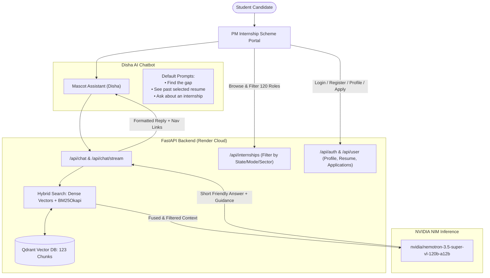

# 🌟 PM Internship Scheme: Disha AI & RAG Architecture Guide

This comprehensive guide details the full technical implementation of the **PM Internship Scheme (PMIS) Platform**, powered by **Disha AI** and **NVIDIA Nemotron 3.5 Super VL (120B-A12B)**.

---

## 📌 Executive Summary of New Upgrades

1. **120 Official Prototype Internships Ingested:**
   - 24 sectors × 5 corporate leads per sector = 120 total structured internship records.
   - Replaced all previous placeholder records with authentic corporate records (TCS, Infosys, HDFC Bank, Tata Motors, L&T, Sun Pharma, NTPC, Reliance, etc.).
   - Full attributes: Title, Sector, Company, Summary, Eligibility / Education, Skills, Location (City, State), Work Mode (Hybrid, On-site, Remote), Duration, Monthly Stipend, and Deadlines (24–30 Oct 2026).

2. **Disha AI — Student Guidance Persona:**
   - Friendly, warm, supportive, and concise.
   - Answers queries shortly (2–4 bullet points) and guides students to the right portal pages.
   - Standard 3 Quick Prompts:
     1. **"Find the gap"** (Skill Gap Analyzer)
     2. **"See past selected resume"** (Winning Resume Formats)
     3. **"Ask about an internship"** (Sector & State Listings)

3. **Clean & Modern Explore Internships Section:**
   - Real company logos for leading corporate brands.
   - Multi-dimensional selection filters:
     - **Select State** (Karnataka, Tamil Nadu, Maharashtra, Delhi / NCR, Pan-India, etc.)
     - **Work Mode** (Hybrid, On-site, Remote/Hybrid)
     - **Sector / Field** (All 24 Sectors)
   - Clean, uncluttered card grid with zero confusion.
   - Detailed modal view and instant one-click application.

4. **Youth Authentication & Registration Flow (Matching Official MCA Mockups):**
   - **Login Modal:** Username / Mobile / CIN + Password with show/hide toggle, Forgot Password, and Google OAuth 2.0.
   - **Register Youth Modal:** 10-digit mobile number, "I confirm that the provided mobile number is unique", Google OAuth 2.0 registration.
   - **Reset Password Modal:** Enter User ID / Mobile / CIN with warning alert iconography.

5. **Student Dashboard & Career Guidance:**
   - Academic Profile (Branch, Degree, College, State).
   - Career Goals & Skills tag manager.
   - Resume Upload (PDF / DOCX) with status indicator.
   - **My Applications Tracker:** Real-time tracking of applied corporate roles.
   - **See Past Selected Resumes:** 4 annotated winning resumes across IT, Finance, Automotive, and Infrastructure with recruiter insights.
   - **Find the Gap:** Instant skill gap comparison between student skills and target sector requirements.

6. **Zero Local PC Dependency on Render:**
   - Self-contained embedded vector store on container disk.
   - Immediate auto-seeding on cold start.
   - Can also connect to Qdrant Cloud free cluster.

---

## 🏗️ Architecture & Query Routing



---

## 🔍 The 24 Sectors & 120 Ingested Records

| # | Sector | Partner Companies |
| :--- | :--- | :--- |
| **1** | **IT & Software Development** | TCS, Infosys, Wipro, HCLTech, Persistent Systems |
| **2** | **Banking & Financial Services** | HDFC Bank, ICICI Bank, State Bank of India, Axis Bank, Bajaj Finance |
| **3** | **Oil, Gas & Energy** | Indian Oil Corporation, ONGC, GAIL, BPCL, HPCL |
| **4** | **Metals & Mining** | Coal India, NMDC, Hindustan Zinc, Vedanta, Tata Steel |
| **5** | **FMCG** | Hindustan Unilever, ITC, Nestlé India, Dabur, Britannia |
| **6** | **Telecommunications** | Bharti Airtel, Vodafone Idea, Reliance Jio, Tata Communications, Tejas Networks |
| **7** | **Infrastructure & Construction** | Larsen & Toubro, Engineers India Limited, IRCON, NBCC, Tata Projects |
| **8** | **Retail & Consumer Durables** | Reliance Retail, Titan Company, Croma, Asian Paints, Whirlpool India |
| **9** | **Cement & Building Materials** | UltraTech Cement, Shree Cement, Wonder Cement, ACC, Ambuja Cements |
| **10** | **Automotive** | Maruti Suzuki, Mahindra & Mahindra, Tata Motors, Hero MotoCorp, TVS Motor |
| **11** | **Pharmaceuticals** | Sun Pharma, Cipla, Dr. Reddy's Laboratories, Lupin, Zydus Lifesciences |
| **12** | **Aviation & Defence** | HAL, Bharat Electronics (BEL), Bharat Dynamics (BDL), Cochin Shipyard, Air India |
| **13** | **Manufacturing & Industrial** | Siemens India, ABB India, Bharat Forge, Thermax, Godrej & Boyce |
| **14** | **Chemical Industry** | UPL, SRF Limited, Aarti Industries, Deepak Nitrite, PI Industries |
| **15** | **Media, Entertainment & Education** | Zee Entertainment, Sony Pictures, PVR INOX, Sun TV, Saregama |
| **16** | **Agriculture & Allied** | Godrej Agrovet, Coromandel, Rallis India, National Seeds Corp, Nuziveedu Seeds |
| **17** | **Consulting Services** | Deloitte India, EY India, KPMG India, PwC India, Grant Thornton |
| **18** | **Textile Manufacturing** | Arvind Limited, Vardhman Textiles, Trident Group, Raymond, Welspun |
| **19** | **Gems & Jewellery** | Titan, Kalyan Jewellers, Senco Gold, Rajesh Exports, PN Gadgil |
| **20** | **Travel & Hospitality** | Taj (IHCL), Oberoi (EIH), ITC Hotels, Lemon Tree, MakeMyTrip |
| **21** | **Healthcare** | Apollo Hospitals, Fortis Healthcare, Max Healthcare, Narayana Health, Metropolis |
| **22** | **Mobility & Transportation** | Ashok Leyland, Bajaj Auto, Ola Electric, Ather Energy, Blue Dart |
| **23** | **Power & Utilities** | NTPC, Power Grid, NHPC, Tata Power, Adani Power |
| **24** | **Logistics & Warehousing** | CONCOR, Delhivery, Gati, VRL Logistics, Safexpress |

---

## 🎯 Step-by-Step RAG Optimization Pipeline

### Step 1: Semantic Entity Extraction
Every record is stored as an independent structured entity. Fields like `skills`, `eligibility`, `stipend`, `mode`, and `deadline` are preserved verbatim so that vector embedding captures both semantic intent and explicit attributes.

### Step 2: Dense Semantic Vectorization
Embeddings are computed using high-dimensional dense vectors (`1024-dim`). When `NVIDIA_API_KEY` is present, it calls `baai/bge-m3` on `https://integrate.api.nvidia.com/v1/embeddings`. A deterministic fallback vectorizer guarantees zero-crash offline local testing.

### Step 3: Sparse Lexical Search (BM25Okapi)
An in-memory Okapi BM25 engine tracks term frequency and inverse document frequency across all companies and titles. Short acronyms like "TCS", "HDFC", "L&T", "ONGC", "HAL", and "BEL" are matched with 100% lexical precision.

### Step 4: Reciprocal Rank Fusion (RRF) & Acronym Boosting
Dense and sparse rankings are combined with Reciprocal Rank Fusion:
$$RRF\_Score(d) = \frac{1}{60 + \text{rank}_{\text{dense}}} + \frac{1}{60 + \text{rank}_{\text{bm25}}}$$
Exact company matches receive a $+0.05$ score boost.

### Step 5: Grounded Prompting for Disha AI
The prompt instructs NVIDIA Nemotron:
* Answer warmly and in 2–4 concise bullet points.
* Guide the student to the **Explore Internships** section, **Student Dashboard**, **Find the Gap**, or **Past Selected Resumes** based on their question.
* Never make up stipends or deadlines.

---

## 📡 REST API Reference

| Method | Endpoint | Description |
| :--- | :--- | :--- |
| `POST` | `/api/chat` | Main Disha AI chat endpoint (receives `{message, history}`) |
| `POST` | `/api/chat/stream` | Server-Sent Events (SSE) real-time streaming endpoint |
| `GET` | `/api/internships` | Filters 120 roles by `sector`, `state`, `mode`, or `q` |
| `GET` | `/api/internships/{id}` | Fetches full record for a specific internship |
| `POST` | `/api/auth/register` | Youth mobile number registration |
| `POST` | `/api/auth/login` | Login with Username / Mobile / CIN + password |
| `POST` | `/api/auth/google` | Google OAuth 2.0 authentication |
| `POST` | `/api/auth/reset-password` | Sends OTP to registered mobile/email |
| `GET` | `/api/user/profile` | Fetches student branch, career goals, skills |
| `PUT` | `/api/user/profile` | Updates student profile & resume |
| `GET` | `/api/user/applications` | Fetches student applied internships |
| `POST` | `/api/user/apply` | Submits internship application |
| `GET` | `/api/resumes/selected` | Fetches 4 anonymized winning resumes |
| `GET` | `/health` | Health check endpoint for Render |
| `GET` | `/api/stats` | Database statistics (points, sectors) |

---

## 🚀 How to Run Locally & Deploy to Render

### 1. Run the Backend Locally:
```bash
cd backend
python -m uvicorn app.main:app --host 0.0.0.0 --port 8000 --reload
```

### 2. Run the Frontend Locally:
```bash
bun dev
# or: npm run dev
```

### 3. Deploy Live to Render:
1. Push repository to GitHub.
2. In Render, select **New Web Service**, choose repo, set Root Directory to `backend`.
3. Add environment variables:
   - `NVIDIA_API_KEY`: Your key from [build.nvidia.com](https://build.nvidia.com)
   - `NVIDIA_LLM_MODEL`: `nvidia/nemotron-3.5-super-vl-120b-a12b`
   - `CORS_ORIGINS`: `*`
4. Deploy! The service auto-indexes on boot. **No connection to your local PC is needed.**
