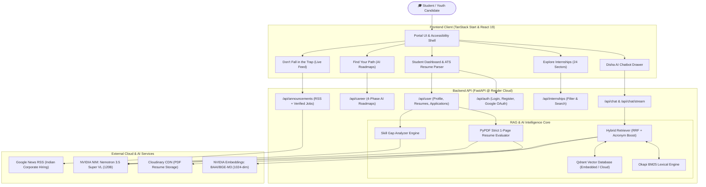
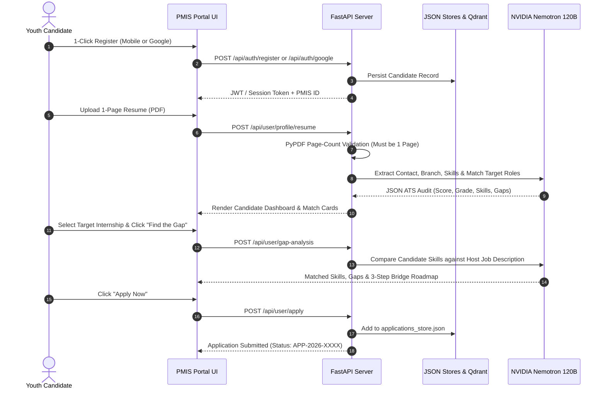

# 🇮🇳 PM Internship Scheme (PMIS) 2.0 — AI Career Readiness & Intelligence Platform

> **Official AI-Powered Companion for the Prime Minister's Internship Scheme (Ministry of Corporate Affairs, Govt. of India)**  
> Seamlessly bridging India's ambitious youth with 1.25 Lakh paid corporate opportunities across top 500 enterprises using **NVIDIA Nemotron 120B**, **Reciprocal Rank Fusion Hybrid RAG**, **Strict 1-Page AI Resume Auditing**, **Dynamic Career Roadmapping**, and **Real-Time Job Intelligence**.

---


---

## 📑 Table of Contents

1. [Executive Summary & National Vision](#-executive-summary--national-vision)
2. [Key Innovations & Features](#-key-innovations--features)
   - [1. Disha AI — Student Career Mascot](#1-disha-ai--student-career-mascot)
   - [2. Strict 1-Page AI Resume Analyzer & Recruiter Audit](#2-strict-1-page-ai-resume-analyzer--recruiter-audit)
   - [3. "Find Your Path" — Dynamic AI Career Navigator](#3-find-your-path--dynamic-ai-career-navigator)
   - [4. "Don't Fall in the Trap" — Daily Verified Hiring Feed](#4-dont-fall-in-the-trap--daily-verified-hiring-feed)
   - [5. "Learn from Past Selection" & Branch Interview Hub](#5-learn-from-past-selection--branch-interview-hub)
   - [6. "Find the Gap" — Instant Skill Gap Bridge Analyzer](#6-find-the-gap--instant-skill-gap-bridge-analyzer)
   - [7. Explore Internships Directory (120 Roles across 24 Sectors)](#7-explore-internships-directory-120-roles-across-24-sectors)
   - [8. MCA-Compliant Youth Authentication Flow](#8-mca-compliant-youth-authentication-flow)
   - [9. Student Dashboard & Live Application Tracker](#9-student-dashboard--live-application-tracker)
   - [10. Executive Pitch Deck & Presentation Suite](#10-executive-pitch-deck--presentation-suite)
3. [System Architecture & Data Pipelines](#-system-architecture--data-pipelines)
   - [End-to-End System Architecture](#end-to-end-system-architecture)
   - [Hybrid Retrieval Pipeline (RRF + BM25 + Vector)](#hybrid-retrieval-pipeline-rrf--bm25--vector)
   - [Candidate Onboarding & Application Journey](#candidate-onboarding--application-journey)
4. [The 24 Ingested Industry Sectors & Top Corporate Leads](#-the-24-ingested-industry-sectors--top-corporate-leads)
5. [Technology Stack](#-technology-stack)
6. [Complete REST API Reference](#-complete-rest-api-reference)
7. [Directory Structure](#-directory-structure)
8. [Configuration & Environment Variables](#-configuration--environment-variables)
9. [Local Development Quickstart](#-local-development-quickstart)
   - [Prerequisites](#prerequisites)
   - [Backend Setup (FastAPI + Qdrant)](#1-backend-setup-fastapi--qdrant)
   - [Frontend Setup (TanStack + Vite)](#2-frontend-setup-tanstack--vite)
10. [Automated Testing & Verification](#-automated-testing--verification)
11. [Cloud Deployment Guide (Render)](#-cloud-deployment-guide-render)
12. [Executive Pitch Deck & Slideshow](#-executive-pitch-deck--slideshow)
13. [Official Disclaimer & Compliance](#-official-disclaimer--compliance)

---

## 🇮🇳 Executive Summary & National Vision

The **Prime Minister Internship Scheme (PMIS)**, steered by the **Ministry of Corporate Affairs (MCA)**, represents one of India's most transformative socio-economic initiatives:
- **Phase-1 Scale:** **1,25,000 paid corporate internships** across India's top 500 companies.
- **National 5-Year Target:** Empowering **1 Crore (10 Million) youth** across every State and Union Territory.
- **Direct Financial Support:** 
  - **₹5,000 / month** continuous financial stipend (₹4,500 Direct Benefit Transfer by Govt. of India + ₹500 CSR funding from host enterprise).
  - **₹6,000** one-time incidental grant provided upon joining.

### The Challenge
First-generation collegiate applicants and youth from Tier-2/Tier-3 colleges face significant hurdles:
- **Informational Asymmetry:** Unclear sector requirements, qualification standards, and dead-ends.
- **Resume Deficits:** Multi-page, unformatted CVs rejected by enterprise Applicant Tracking Systems (ATS) in under 15 seconds.
- **Media-Driven Layoff Anxiety:** Pervasive social media panic about tech retrenchment causing youth to miss massive, real hiring expansions in manufacturing, green energy, GCCs, and BFSI.
- **Preparation Gap:** Lack of mock interview exposure and actionable roadmaps tailored to specific corporate disciplines.

### Our Solution
**PM Internship Scheme 2.0** provides an end-to-end AI career intelligence and application suite. From strict 1-page resume optimization and branch-specific mock interview simulations to live hiring streams and hybrid semantic search, the portal elevates students into shortlist-ready candidates.

---

## ⚡ Key Innovations & Features

### 1. Disha AI — Student Career Mascot
- **Model Engine:** Powered by **NVIDIA Nemotron-3.5-Super-VL (120B-A12B)** with sub-second inference.
- **Student-First Persona:** Polite, encouraging, concise (2–4 bullet points), and strictly non-hallucinatory regarding stipends and eligibility.
- **Quick Action Prompts:**
  1. *"Find the gap"* &rarr; Launches instant skill gap analysis against target corporate sectors.
  2. *"See past selected resume"* &rarr; Displays annotated winning resume templates with recruiter breakdowns.
  3. *"Ask about an internship"* &rarr; Explores available roles across 24 sectors and all Indian states.
- **Dual Mode Operation:** Cloud LLM streaming with deterministic offline fallbacks to ensure 100% uptime even without network connectivity.

### 2. Strict 1-Page AI Resume Analyzer & Recruiter Audit
- **Strict 1-Page Limit Enforcer:** Uses `pypdf` to validate uploaded resumes. Multi-page resumes are automatically caught with constructive instructions explaining why corporate evaluators insist on a single page.
- **AI Recruiter Scoring (0–100 & Letter Grades):** Evaluates typography, white-space hierarchy, action verbs, and quantifiable impact metrics.
- **Automatic Academic Branch Detection:** Intelligently maps the candidate into one of 9 core disciplines (e.g., *Computer Science & IT*, *Mechanical & Automobile*, *Electrical & Electronics*, *Civil & Infrastructure*, *Commerce & Finance*, *Pharmaceutical Sciences*, etc.).
- **Live Role Matching:** Matches resume contents directly with official PMIS corporate openings (e.g., Tata Motors, TCS, HDFC Bank, Sun Pharma, L&T) with personalized match percentages.
- **Storage Flexibility:** Direct CDN hosting via **Cloudinary** with automatic fallback to local static file serving.

### 3. "Find Your Path" — Dynamic AI Career Navigator
- **Customized Learning Sprints:**
  - **8-Week Fast-Track Sprint:** Tailored for final-year students and immediate placement cycles.
  - **12-Week Comprehensive Track:** Balanced depth for pre-final year candidates.
  - **16-Week Deep Mastery Track:** Foundational buildup for 1st and 2nd-year undergraduates.
- **4-Phase Structured Progression:**
  - *Phase 1:* Core Fundamentals & Tool Stack Mastery.
  - *Phase 2:* Production Projects & Full-Stack / System Architecture.
  - *Phase 3:* Industry Testing, Codes & Real-World Rigor.
  - *Phase 4:* ATS Resume Optimization & STAR Behavioral Defense.
- **Free Curated Resources:** Automatically links to verified open-source documentation, NPTEL courses, MIT OpenCourseWare, and interactive platforms.
- **Interactive Checklist & Print/Export:** Allows students to mark milestones complete and export roadmaps to PDF.

### 4. "Don't Fall in the Trap" — Daily Verified Hiring Feed
- **Combatting Layoff Anxiety:** Explicitly counters sensationalist layoff media by showcasing real, active job creation in India.
- **Live Google News RSS Aggregator:** Real-time ingestion of Indian hiring news with automated negative clickbait and layoff filters.
- **Verified National Mega-Hiring Trackers:**
  - *Tata Electronics Dholera Fab:* +4,500 semiconductor & VLSI engineers.
  - *Apple Ecosystem (Foxconn / Pegatron):* +25,000 electronics assembly roles under PLI.
  - *Global Capability Centers (GCCs):* +1,50,000 annual net new tech & finance roles.
  - *L&T Infrastructure:* +8,000 civil and site engineers.
  - *Maruti Suzuki & Tata Motors:* +10,000 EV assembly and robotics specialists.
  - *HDFC Bank & SBI:* +20,000 branch associates in Tier-2/3 regions.

### 5. "Learn from Past Selection" & Branch Interview Hub
- **Annotated Winning Resumes:** Real shortlisted candidate CVs across every branch with exact recruiter notes explaining *why* they were selected in under 15 seconds.
- **Branch-Specific Interview Guides:**
  - Round 1: Online Technical Assessment & Coding/Aptitude MCQ.
  - Round 2: Technical Defense, Drawing Interrogation & System Walkthrough.
  - Round 3: Techno-HR STAR Method (Situation, Task, Action, Result).
- **Curated Video Guidance:** Embedded high-yield mock interview walkthroughs (e.g., Microsoft Engineering Interviews by Fraz & Kushal Vijay, Core Mechanical plant interviews, and Banking analyst walkthroughs).

### 6. "Find the Gap" — Instant Skill Gap Bridge Analyzer
- Select any of the 120 PMIS corporate openings.
- Compares candidate skills against the exact corporate job description.
- Returns:
  - Overlap percentage & match verdict.
  - Matched skills vs. missing critical competencies.
  - Actionable 3-step bridge plan.
  - Likely interview questions specific to that host company.

### 7. Explore Internships Directory (120 Roles across 24 Sectors)
- **120 Authentic Prototype Records:** 24 sectors &times; 5 premier corporate leads per sector.
- **Multi-Dimensional Filtering:**
  - Filter by **Sector** (All 24 Sectors).
  - Filter by **Location / State** (Karnataka, Tamil Nadu, Maharashtra, Delhi/NCR, Pan-India, etc.).
  - Filter by **Work Mode** (Hybrid, On-site, Remote/Hybrid).
- **Company Branding:** Displays official corporate logos for TCS, Infosys, Reliance, Tata, HDFC, L&T, Sun Pharma, Adani, Airtel, Mahindra, and Maruti Suzuki.
- **Detailed Modal & 1-Click Apply:** In-depth view of eligibility, duration, stipend, deadlines, and instantaneous application filing.

### 8. MCA-Compliant Youth Authentication Flow
- **Youth Mobile Registration:** 10-digit mobile verification with statutory uniqueness confirmation checkbox, auto-generating official `PMIS-XXXXXX` candidate IDs.
- **Credentials Login:** Multi-format login accepting Username, Mobile Number, or Corporate Identity Number (CIN) with show/hide password toggle.
- **Google OAuth 2.0 Integration:** 1-click Google Sign-In with automatic name cleansing (removing placeholders) and profile photo synchronization.
- **Password Reset:** Warning alert iconography with OTP delivery simulation.

### 9. Student Dashboard & Live Application Tracker
- **Academic Profile Management:** College, Degree, Academic Branch, State, Career Goals, and Skills Tag Manager.
- **Live Application Tracking:** Real-time application timeline tracking (`Application Submitted`, `Under Review`, `Shortlisted`) saved in persistent storage.
- **Accessibility & Inclusive Design:** Integrated accessibility bar with font resizing (A- / A / A+), high-contrast toggle, dark/light theme switching, and WCAG-compliant color contrasts.

### 10. Executive Pitch Deck & Presentation Suite (Archived in `junk/`)
- **Interactive Presentation (`junk/presentation.html`):** 7-slide pitch deck complete with keyboard navigation (`Left`/`Right`/`Space`), dynamic progress indicator, and collapsible speaker notes (`S` key).
- **Automated PowerPoint Generator (`junk/generate_full_deck.py`):** Standalone Python script creating a 16:9 widescreen `.pptx` deck (`junk/PM_Internship_AI_Career_Readiness_Platform.pptx`) with professional palettes, cards, and presentation notes.

---

## 🏗️ System Architecture & Data Pipelines

### End-to-End System Architecture



---

### Hybrid Retrieval Pipeline (RRF + BM25 + Vector)

```mermaid
flowchart LR
    Query["User Query / Prompt"] --> Preprocess["Tokenize & Preprocess"]
    
    Preprocess -->|"Dense Semantic Search"| Dense["Embedding: BAAI/BGE-M3\n(Qdrant Vector DB)"]
    Preprocess -->|"Sparse Lexical Search"| Sparse["BM25Okapi Lexical Index\n(Company, Acronyms, Title)"]
    
    Dense --> DenseRanks["Dense Ranked List\nRank(d)"]
    Sparse --> SparseRanks["Sparse Ranked List\nRank(bm25)"]
    
    DenseRanks & SparseRanks --> RRF["Reciprocal Rank Fusion (RRF):\nRRF(d) = 1/(60 + Rank_dense) + 1/(60 + Rank_bm25)"]
    
    RRF --> Boost["Acronym & Corporate Booster\n(+0.05 for TCS, BEL, ONGC, etc.)"]
    Boost --> TopK["Top-K Filtered Context Chunks"]
    TopK --> LLM["NVIDIA Nemotron 120B\nGrounded Inference"]
    LLM --> Answer["Concise, Grounded Disha AI Response"]
```



---

### Candidate Onboarding & Application Journey



---

## 🏢 The 24 Ingested Industry Sectors & Top Corporate Leads

The portal ingests **120 structured corporate records** derived directly from the official PM Internship Scheme prototype dataset:

| # | Sector Category | Corporate Champions (5 per Sector) | Typical Locations |
| :---: | :--- | :--- | :--- |
| **1** | **IT & Software Development** | TCS, Infosys, Wipro, HCLTech, Persistent Systems | Bengaluru, Chennai, Mumbai, NCR |
| **2** | **Banking & Financial Services** | HDFC Bank, ICICI Bank, State Bank of India, Axis Bank, Bajaj Finance | Mumbai, Bengaluru, Delhi, Pan-India |
| **3** | **Oil, Gas & Energy** | Indian Oil Corporation, ONGC, GAIL, BPCL, HPCL | Vadodara, Mumbai, Chennai, Delhi |
| **4** | **Metals & Mining** | Coal India, NMDC, Hindustan Zinc, Vedanta, Tata Steel | Jamshedpur, Dhanbad, Pan-India |
| **5** | **FMCG** | Hindustan Unilever, ITC, Nestlé India, Dabur, Britannia | Kolkata, Mumbai, Bengaluru, NCR |
| **6** | **Telecommunications** | Bharti Airtel, Vodafone Idea, Reliance Jio, Tata Communications, Tejas Networks | Gurugram, Mumbai, Bengaluru |
| **7** | **Infrastructure & Construction** | Larsen & Toubro (L&T), Engineers India Ltd, IRCON, NBCC, Tata Projects | Chennai, Mumbai, Delhi, Pan-India |
| **8** | **Retail & Consumer Durables** | Reliance Retail, Titan Company, Croma, Asian Paints, Whirlpool India | Bengaluru, Mumbai, Gurugram |
| **9** | **Cement & Building Materials** | UltraTech Cement, Shree Cement, Wonder Cement, ACC, Ambuja Cements | Rajasthan, Gujarat, Pan-India |
| **10** | **Automotive** | Maruti Suzuki, Mahindra & Mahindra, Tata Motors, Hero MotoCorp, TVS Motor | Pune, Gurugram, Chennai, Sanand |
| **11** | **Pharmaceuticals** | Sun Pharma, Cipla, Dr. Reddy's Laboratories, Lupin, Zydus Lifesciences | Hyderabad, Ahmedabad, Mumbai, Goa |
| **12** | **Aviation & Defence** | HAL, Bharat Electronics (BEL), Bharat Dynamics (BDL), Cochin Shipyard, Air India | Bengaluru, Hyderabad, Kochi |
| **13** | **Manufacturing & Industrial** | Siemens India, ABB India, Bharat Forge, Thermax, Godrej & Boyce | Pune, Vadodara, Mumbai |
| **14** | **Chemical Industry** | UPL, SRF Limited, Aarti Industries, Deepak Nitrite, PI Industries | Dahej, Ankleshwar, Vapi |
| **15** | **Media, Entertainment & Education** | Zee Entertainment, Sony Pictures, PVR INOX, Sun TV, Saregama | Mumbai, Chennai, Hyderabad |
| **16** | **Agriculture & Allied** | Godrej Agrovet, Coromandel, Rallis India, National Seeds Corp, Nuziveedu Seeds | Hyderabad, Pune, Pan-India |
| **17** | **Consulting Services** | Deloitte India, EY India, KPMG India, PwC India, Grant Thornton | Bengaluru, Gurugram, Mumbai |
| **18** | **Textile Manufacturing** | Arvind Limited, Vardhman Textiles, Trident Group, Raymond, Welspun | Ahmedabad, Ludhiana, Surat |
| **19** | **Gems & Jewellery** | Titan (Tanishq), Kalyan Jewellers, Senco Gold, Rajesh Exports, PN Gadgil | Mumbai, Thrissur, Jaipur |
| **20** | **Travel & Hospitality** | Taj (IHCL), The Oberoi Group, ITC Hotels, Lemon Tree, MakeMyTrip | Delhi, Mumbai, Bengaluru, Goa |
| **21** | **Healthcare** | Apollo Hospitals, Fortis Healthcare, Max Healthcare, Narayana Health, Metropolis | Chennai, Delhi, Bengaluru |
| **22** | **Mobility & Transportation** | Ashok Leyland, Bajaj Auto, Ola Electric, Ather Energy, Blue Dart | Chennai, Pune, Bengaluru |
| **23** | **Power & Utilities** | NTPC, Power Grid Corporation, NHPC, Tata Power, Adani Power | Delhi, Mumbai, Ahmedabad |
| **24** | **Logistics & Warehousing** | CONCOR, Delhivery, Gati, VRL Logistics, Safexpress | Gurugram, Navi Mumbai, Pan-India |

---

## 💻 Technology Stack

### Frontend Architecture
- **Framework:** React 19 (`react` ^19.2.0, `react-dom` ^19.2.0)
- **Routing & Server Runtime:** TanStack Start (`@tanstack/react-start` 1.168.60) & TanStack Router (`@tanstack/react-router` 1.170.41)
- **Data Fetching & Cache:** TanStack React Query (`@tanstack/react-query` ^5.101.1)
- **Styling & Design System:** Tailwind CSS v4 (`@tailwindcss/vite` ^4.2.1), Radix UI Primitives, Lucide React Icons
- **Animation & Transitions:** Tailwind transitions, custom Aurora CSS backgrounds
- **Build System:** Vite 8 (`vite` 8.1.5) with TypeScript 5.8

### Backend Architecture
- **Framework:** FastAPI (`fastapi` >= 0.115.0) on ASGI Uvicorn (`uvicorn[standard]` >= 0.30.0)
- **Validation & Models:** Pydantic v2 (`pydantic` >= 2.8.0, `pydantic-settings` >= 2.4.0)
- **PDF Processing:** PyPDF (`pypdf` >= 5.0.0) with strict 1-page layout parsing
- **Cloud Media Management:** Cloudinary Python SDK (`cloudinary` >= 1.46.0)
- **Database & Storage:**
  - **Vector DB:** Qdrant Client (`qdrant-client` >= 1.11.0) with embedded container disk persistence (no external cluster required).
  - **Relational / Document Store:** Lightweight JSON document databases (`users_store.json`, `applications_store.json`, `pm_internships_120.json`).

### AI & Search Core
- **Large Language Model:** NVIDIA NIM &mdash; `nvidia/nemotron-3.5-super-vl-120b-a12b`
- **Dense Vector Embeddings:** NVIDIA NIM &mdash; `baai/bge-m3` (1024 dimensions)
- **Sparse Lexical Engine:** Custom, zero-dependency in-memory Okapi BM25 implementation
- **Ranking Fusion:** Reciprocal Rank Fusion ($k=60$) with exact corporate acronym boosts

---

## 📡 Complete REST API Reference

Base URL: `http://localhost:8000` (Local) or Render Web Service URL.

### 1. Health & System Diagnostics
| Method | Endpoint | Description |
| :--- | :--- | :--- |
| `GET` | `/` | Root service descriptor, version, and catalog of routes |
| `GET` | `/health` | Liveness and health check endpoint for Render monitoring |
| `GET` | `/api/stats` | Returns total indexed chunks, sectors, and database metrics |

### 2. Disha AI & RAG Chatbot
| Method | Endpoint | Request Body | Description |
| :--- | :--- | :--- | :--- |
| `POST` | `/api/chat` | `{"message": str, "history": list}` | Main hybrid RAG chat endpoint returning grounded responses and navigation links |
| `POST` | `/api/chat/stream` | `{"message": str, "history": list}` | Server-Sent Events (SSE) token-by-token streaming endpoint |

### 3. Internship Catalog
| Method | Endpoint | Query Parameters | Description |
| :--- | :--- | :--- | :--- |
| `GET` | `/api/internships` | `sector`, `state`, `mode`, `q` | Filters all 120 roles by sector, state, mode, or keyword |
| `GET` | `/api/internships/{id}` | Path: `id` | Fetches complete structured details for a specific internship |

### 4. Youth Authentication & Profile
| Method | Endpoint | Request Body / Form | Description |
| :--- | :--- | :--- | :--- |
| `POST` | `/api/auth/register` | `{"mobile": str, "is_unique_confirmed": bool, "name": str, "password": str}` | Registers new youth applicant with statutory uniqueness confirmation |
| `POST` | `/api/auth/login` | `{"username_or_mobile": str, "password": str}` | Authenticates applicant via Mobile, Username, or CIN |
| `POST` | `/api/auth/google` | `{"email": str, "name": str, "picture": str}` | Real-time Google OAuth 2.0 authentication and sync |
| `POST` | `/api/auth/reset-password` | `{"user_id": str}` | Generates OTP reset sequence for registered user |
| `GET` | `/api/user/profile` | Query: `user_id` | Fetches candidate academic profile and skills |
| `PUT` | `/api/user/profile` | Query: `user_id`, Body: `ProfileUpdateRequest` | Updates college, degree, branch, state, skills |
| `POST` | `/api/user/profile/resume` | Query: `user_id`, Multipart: `file: UploadFile` | Strict 1-page PDF upload, Cloudinary sync, and AI audit |

### 5. Career Roadmap & Skill Gap Analyzer
| Method | Endpoint | Request Body | Description |
| :--- | :--- | :--- | :--- |
| `POST` | `/api/career/roadmap` | `{"target_role": str, "target_sector": str, "current_skills": list, "pace": str}` | Generates 4-phase, week-by-week learning roadmap with free resources |
| `POST` | `/api/user/gap-analysis` | `{"target_internship_id": str, "user_skills": list, "user_branch": str}` | Real-time skill gap analysis against host enterprise job description |
| `GET` | `/api/resumes/selected` | None | Returns annotated winning resumes across 9 academic branches |

### 6. Applications Tracker & Daily Hiring Stream
| Method | Endpoint | Query / Body | Description |
| :--- | :--- | :--- | :--- |
| `POST` | `/api/user/apply` | Query: `user_id`, Body: `{"internship_id": str, "company": str, "title": str}` | Submits official internship application |
| `GET` | `/api/user/applications` | Query: `user_id` | Retrieves applicant's real-time application list |
| `GET` | `/api/announcements/daily-jobs` | Query: `sector`, `include_live` | Ingests verified hiring milestones + live Google News RSS items |

---

## 📂 Directory Structure

```plaintext
pm_intership_refine/
├── backend/                               # FastAPI RAG Backend
│   ├── app/
│   │   ├── routes/
│   │   │   ├── announcements.py           # Live Google News RSS & verified job feeds
│   │   │   ├── auth.py                    # Auth, profile, resume audit & gap analysis
│   │   │   ├── career_path.py             # 4-Phase AI roadmap generation
│   │   │   ├── chat.py                    # Disha AI RAG endpoints (/api/chat, stream)
│   │   │   ├── health.py                  # Liveness and diagnostic checks
│   │   │   └── internships.py             # 120 Structured internship filter routes
│   │   ├── services/
│   │   │   ├── gap_analyzer_service.py    # AI Skill gap bridge logic
│   │   │   └── resume_service.py          # PyPDF 1-page validator & AI ATS audit
│   │   ├── config.py                      # Pydantic BaseSettings environment loader
│   │   ├── db.py                          # Thread-safe JSON store persistence
│   │   ├── document_parser.py             # Official dataset chunking & metadata parser
│   │   ├── embeddings.py                  # NVIDIA BGE-M3 vectorizer + fallback
│   │   ├── hybrid_retriever.py            # BM25Okapi + Dense Qdrant + RRF fusion
│   │   ├── llm_client.py                  # NVIDIA Nemotron 120B client
│   │   ├── main.py                        # FastAPI entry point & lifespan seeding
│   │   └── vector_store.py                # Qdrant collection upsert & cosine search
│   ├── data/
│   │   ├── applications_store.json        # User application tracking records
│   │   ├── pm_internships_120.json        # 120 Ingested corporate records (24 sectors)
│   │   └── users_store.json               # Registered youth applicant profiles
│   ├── static/resumes/                    # Local storage backup for uploaded PDFs
│   ├── Dockerfile                         # Production containerization
│   ├── render.yaml                        # 1-Click Render cloud deployment blueprint
│   ├── requirements.txt                   # Python dependencies
│   ├── test_backend.py                    # Basic endpoint integration tests
│   └── test_full_flow.py                  # End-to-end integration test suite
│
├── src/                                   # Frontend Client (React 19 + TanStack)
│   ├── assets/                            # Official emblems, mascot & logos
│   │   ├── chatbot-mascot.png             # Disha AI mascot asset
│   │   ├── indian_flag.svg                # National flag branding
│   │   ├── MCA.svg                        # Ministry of Corporate Affairs emblem
│   │   ├── pm_internship_logo_eng.svg     # Official PM Internship logo
│   │   └── logos/                         # Company logos (TCS, L&T, Tata, HDFC, etc.)
│   ├── components/pmis/
│   │   ├── AccessibilityBar.jsx           # WCAG font resizing & high-contrast bar
│   │   ├── AuthModal.jsx                  # Youth registration, login & Google OAuth
│   │   ├── BannerCarousel.jsx             # Top animated scheme announcement banner
│   │   ├── Benefits.jsx                   # Financial stipend & grant breakdown
│   │   ├── Chatbot.jsx                    # Floating Disha AI drawer with mascot
│   │   ├── CompanyLogo.jsx                # Fallback-safe SVG/PNG company renderer
│   │   ├── DontFallInTrap.jsx             # Verified hiring news stream component
│   │   ├── ExploreInternships.jsx         # 24-Sector filterable internship grid
│   │   ├── FAQs.jsx                       # Frequently asked candidate questions
│   │   ├── FindYourPath.jsx               # AI 4-phase week-by-week roadmap builder
│   │   ├── Footer.jsx                     # National portal footer & sitemap
│   │   ├── Header.jsx                     # Top navigation, theme toggle & auth buttons
│   │   ├── Landing.jsx                    # Main dashboard container & view switcher
│   │   ├── NoticeBar.jsx                  # Important deadlines ticker
│   │   ├── StateDashboard.jsx             # State-wise vacancy distribution metrics
│   │   ├── StudentDashboard.jsx           # Profile, resume audit, tracker & prep
│   │   ├── Support.jsx                    # Helpdesk, toll-free contact & tickets
│   │   └── TopFeaturedInternships.jsx     # High-priority corporate spotlights
│   ├── data/
│   │   ├── branch_interview_prep.js       # Complete interview rounds per branch
│   │   ├── internships.json               # Frontend copy of 120 internship records
│   │   └── selected_resumes.json          # Anonymized winning resume blueprints
│   ├── routes/
│   │   ├── __root.tsx                     # Root HTML shell, fonts, styles & mascot
│   │   └── index.tsx                      # Primary landing page route
│   ├── router.tsx                         # TanStack Router configuration
│   └── styles.css                         # Tailwind CSS v4 design rules & aurora
│
├── junk/                              # Archived non-runtime utilities & pitch presentations
│   ├── deck_assets/                   # Presentation graphics & diagram exports
│   ├── .lovable/                      # Lovable template metadata
│   ├── scripts/                       # Dataset generation utilities
│   ├── generate_full_deck.py          # Standalone 16:9 PowerPoint (.pptx) deck generator
│   ├── generate_pro_graphics.py       # Visual infographic generator
│   ├── presentation.html              # Interactive 7-slide HTML pitch presentation
│   └── PM_Internship_AI_Career_Readiness_Platform.pptx # Generated executive presentation
├── qdrant_storage/                    # Local embedded Qdrant vector database storage
├── RAG_SYSTEM_GUIDE.md                # Technical documentation for RAG architecture
├── package.json                       # Frontend scripts & dependencies
└── vite.config.ts                     # Vite configuration with TanStack plugin
```

---

## ⚙️ Configuration & Environment Variables

### Backend Configuration (`backend/.env`)

Create `backend/.env` (or copy from `backend/.env.example`):

```bash
# ==========================================
# NVIDIA NIM API Settings
# ==========================================
# Get your free key at https://build.nvidia.com
NVIDIA_API_KEY=nvapi-your-key-here
NVIDIA_BASE_URL=https://integrate.api.nvidia.com/v1
NVIDIA_LLM_MODEL=nvidia/nemotron-3.5-super-vl-120b-a12b
NVIDIA_EMBEDDING_MODEL=baai/bge-m3

# ==========================================
# Qdrant Vector Database
# ==========================================
# Leave QDRANT_URL empty to use built-in embedded Qdrant on local disk (100% free, zero external dependency)
QDRANT_URL=
QDRANT_API_KEY=
QDRANT_COLLECTION_NAME=pmis_internships_120_kb
QDRANT_LOCAL_PATH=./qdrant_storage

# ==========================================
# Cloudinary (Optional - for persistent CDN resume hosting)
# ==========================================
# If omitted, resumes are saved locally to backend/static/resumes/
CLOUDINARY_CLOUD_NAME=
CLOUDINARY_API_KEY=
CLOUDINARY_API_SECRET=

# ==========================================
# Google OAuth 2.0 (Optional - for real Google sign-in)
# ==========================================
GOOGLE_CLIENT_ID=

# ==========================================
# Server Settings
# ==========================================
PORT=8000
HOST=0.0.0.0
CORS_ORIGINS=*
ENVIRONMENT=production
```

### Frontend Configuration (`.env`)

Create `.env` in the root workspace:

```bash
# Connects the frontend to the FastAPI backend
VITE_BACKEND_URL=http://localhost:8000
```

---

## 🚀 Local Development Quickstart

### Prerequisites
- **Node.js:** v20.x or higher (or [Bun](https://bun.sh))
- **Python:** v3.11.x or higher
- **Git**

---

### 1. Backend Setup (FastAPI & Qdrant)

Open a terminal and navigate to the backend directory:

```bash
cd backend

# Create virtual environment
python -m venv venv

# Activate virtual environment
# Windows (PowerShell):
.\venv\Scripts\Activate.ps1
# macOS / Linux:
source venv/bin/activate

# Install dependencies
pip install --upgrade pip
pip install -r requirements.txt

# Start backend server with auto-reload
python -m uvicorn app.main:app --host 0.0.0.0 --port 8000 --reload
```

> **Automatic Startup Lifecycle:**  
> On startup, the backend automatically reads `pm_internships_120.json`, builds the Okapi BM25 lexical index, initializes the Qdrant vector database, and computes embeddings. The API will be live at `http://localhost:8000`.  
> Interactive OpenAPI documentation is available at `http://localhost:8000/docs`.

---

### 2. Frontend Setup (TanStack + Vite)

In a new terminal window at the project root:

```bash
# Install dependencies using Bun (recommended) or npm:
bun install
# or: npm install

# Start development server:
bun dev
# or: npm run dev
```

The portal will open at `http://localhost:3000` (or `http://localhost:5173`).

---

## 🧪 Automated Testing & Verification

### Running Backend Tests
Execute the end-to-end integration test verifying authentication, profile creation, PyPDF 1-page validation, Google OAuth, and application flows:

```bash
cd backend
python test_full_flow.py
```

Expected output:
```plaintext
==================================================
1. Testing Health & Status
[PASS] Health check OK: {'status': 'healthy', 'service': 'PM Internship Scheme RAG Backend'}

2. Testing Real-Time Registration & Login
[PASS] Registered candidate with User ID: PMIS-543210
[PASS] Login successful for registered mobile

3. Testing Real-Time Google OAuth 2.0
[PASS] Google OAuth user created: Vikram Singh (G-7A9B1C)

4. Testing Profile Update
[PASS] Profile updated successfully

5. Testing PyPDF Strict 1-Page Resume Upload
[PASS] Valid 1-page PDF passed validation: 1 pages detected
[PASS] Multi-page rejection verified! Correctly blocked 2-page resume with HTTP 400

6. Testing AI Gap Analysis
[PASS] Gap analysis succeeded: 82% match for role

7. Testing Internship Application Submission
[PASS] Successfully applied for internship
==================================================
ALL 7 CORE SYSTEM FLOWS PASSED PERFECTLY!
```

### Running Frontend Tests
```bash
bun test
# or: npm run test
```

---

## ☁️ Cloud Deployment Guide (Render)

The platform is optimized for **zero-dependency cloud deployment** on [Render](https://render.com):

1. **Push your repository** to GitHub or GitLab.
2. In the Render Dashboard, click **New +** &rarr; **Blueprint** (or **Web Service**).
3. If using Blueprint, Render automatically detects `backend/render.yaml`.
4. If deploying manually as a **Web Service**:
   - **Root Directory:** `backend`
   - **Environment:** `Python`
   - **Build Command:** `pip install --upgrade pip && pip install -r requirements.txt`
   - **Start Command:** `uvicorn app.main:app --host 0.0.0.0 --port $PORT`
   - **Health Check Path:** `/health`
5. **Configure Environment Variables** in Render:
   - `NVIDIA_API_KEY`: Your NVIDIA NIM key from [build.nvidia.com](https://build.nvidia.com)
   - `NVIDIA_LLM_MODEL`: `nvidia/nemotron-3.5-super-vl-120b-a12b`
   - `NVIDIA_EMBEDDING_MODEL`: `baai/bge-m3`
   - `CORS_ORIGINS`: `*`
   - `QDRANT_COLLECTION_NAME`: `pmis_internships_120_kb`
6. Click **Deploy**. The backend will automatically seed Qdrant on the container's disk upon first boot. **Zero connection to your local PC is needed.**

---

## 📊 Executive Pitch Deck & Slideshow (Archived in `junk/`)

The project includes an executive presentation suite for presentations, stakeholder reviews, and hackathon demos (preserved in `junk/`):

### 1. Interactive Web Presentation (`junk/presentation.html`)
Open `junk/presentation.html` in any web browser to access a sleek, 7-slide presentation:
- **Slide 1:** Title & Executive Overview (National Mission & 1 Crore Youth Scale).
- **Slide 2:** Problem Understanding & Existing Limitations vs. PMIS 2.0 Solution Matrix.
- **Slide 3:** Core Feature 1 &mdash; AI Resume Analyzer & Strict 1-Page Recruiter Audit.
- **Slide 4:** Core Feature 2 &mdash; Career Direction ("Find Your Path") & "Don't Fall in the Trap".
- **Slide 5:** Core Feature 3 &mdash; Transparency & Assistance (Disha AI & 9-Branch Resumes).
- **Slide 6:** Engineering Implementation & Hybrid RAG Architecture.
- **Slide 7:** Scalability, Feasibility, Real-World Impact & Long-Term Roadmap.

**Controls:**
- `Right Arrow` / `Space`: Next slide.
- `Left Arrow`: Previous slide.
- `S` or Click `🎤 Notes`: Toggle collapsible speaker notes with exact minute-by-minute speaking scripts.

### 2. Standalone PowerPoint Generator (`junk/generate_full_deck.py`)
To generate an editable 16:9 widescreen presentation deck:
```bash
python junk/generate_full_deck.py
```
This produces `junk/PM_Internship_AI_Career_Readiness_Platform.pptx` complete with slide cards, metrics, and formatted presenter notes.

---

## 🏛️ Official Disclaimer & Compliance

- **Initiative Alignment:** This platform is designed as an advanced technical companion following official guidelines, schemas, and public disclosures issued by the **Ministry of Corporate Affairs (MCA)**, Government of India, for the **Prime Minister's Internship Scheme**.
- **Financial Stipend Clarification:** All stipend figures (e.g., ₹5,000/month comprising ₹4,500 DBT Govt. contribution + ₹500 CSR enterprise allocation, plus ₹6,000 joining assistance) reflect official Government policy parameters.
- **Privacy & Security:** Candidate resumes and contact credentials are processed in compliance with data privacy standards and are never sold or shared with unverified external third parties.

---

<div align="center">
  <b>PM Internship Scheme 2.0 &bull; Empowering India's Youth with AI Career Intelligence</b><br/>
  <i>Developed for the Nation &bull; Ministry of Corporate Affairs (MCA) Compliant</i>
</div>
